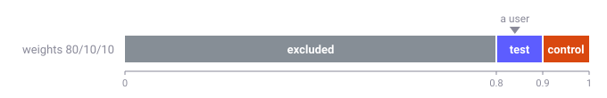
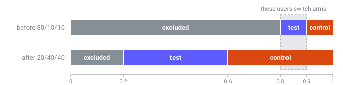
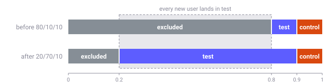
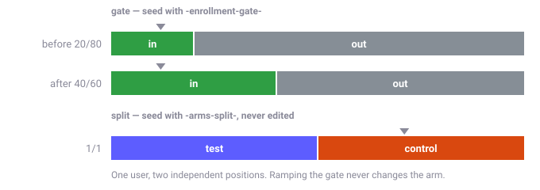
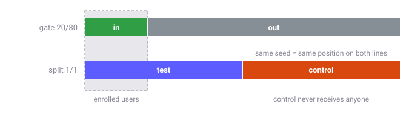

# Running A/B Experiments

The [fractional](../reference/custom-operations/fractional-operation.md) operation can split users between arms of an experiment.
This guide starts with the simple way to set one up, shows where it breaks, then shows a setup that doesn't.

Examples use `test`, `control` and `excluded` (users not in the experiment).
These names are a convention, not something flagd requires.

## The simple approach

One fractional with three arms.
Here 20% of users are enrolled, split evenly between `test` and `control`:

```json
{
  "$schema": "https://flagd.dev/schema/v0/flags.json",
  "flags": {
    "checkout-experiment": {
      "state": "ENABLED",
      "variants": {
        "test": "test",
        "control": "control",
        "excluded": "excluded"
      },
      "defaultVariant": "excluded",
      "targeting": {
        "fractional": [
          ["excluded", 80],
          ["test", 10],
          ["control", 10]
        ]
      }
    }
  }
}
```

With no bucketing expression, flagd hashes `[flagKey, targetingKey]`.
Users without a `targetingKey` get `defaultVariant`.

This works.
Each user always gets the same arm, as long as the flag doesn't change.
The problems start when it does.

## How a user gets an arm

flagd hashes the bucketing value to a fixed point between 0 and 1.
The weights cut that line into slices, in list order.
The user gets the slice their point falls in.



The point never moves.
The slices move whenever you change weights, add arms or reorder them.

## Drawbacks of the simple approach

### Growing the experiment moves users

To enroll 80%, the obvious edit is `20/40/40`.
Every user who was in `test` is now in `control`.



### Keeping users in place skews intake

You can keep existing users in place by giving all the new weight to the arm next to `excluded`: `20/70/10`.
Then every newly enrolled user lands in `test`.



With one fractional, you have to choose between moving users and unbalanced intake.

A flat split is fine if its weights never change.
Otherwise, use the setup below.

## Gate and split

Use two fractionals instead:

- a **gate** decides who is enrolled (`in` / `out`)
- a **split** decides the arm (`test` / `control`)

Each one hashes a different seed, so each user has two independent points.
To grow the experiment, change only the gate.
The `in` slice grows, and the split never moves.



```json
{
  "$schema": "https://flagd.dev/schema/v0/flags.json",
  "flags": {
    "checkout-experiment": {
      "state": "ENABLED",
      "variants": {
        "test": "test",
        "control": "control",
        "excluded": "excluded"
      },
      "defaultVariant": "excluded",
      "targeting": {
        "if": [
          { "!!": [{ "var": "targetingKey" }] },
          { "if": [
            { "==": [
              { "fractional": [
                { "cat": [
                  { "var": "$flagd.flagKey" },
                  "-enrollment-gate-",
                  { "var": "targetingKey" }
                ] },
                ["in", 20],
                ["out", 80]
              ] },
              "in"
            ] },
            { "fractional": [
              { "cat": [
                { "var": "$flagd.flagKey" },
                "-arms-split-",
                { "var": "targetingKey" }
              ] },
              ["test", 1],
              ["control", 1]
            ] },
            "excluded"
          ] }
        ]
      }
    }
  }
}
```

- Each stage needs its own seed, so each one uses an explicit `cat` expression instead of the default.
- `cat` doesn't fail when `targetingKey` is missing: it returns a constant, so every user without a key would land in the same bucket. The `!!` guard sends them to `defaultVariant` instead.
- `in` and `out` are not variants. They are only compared by `==`.
- Ramping from 20% to 40% moves no one between arms, and new users split evenly.

### Use different seeds

If gate and split hash the same value, a user sits at the same point on both lines.
Enrolled users all come from the low end of the gate, so here they all land in `test`.



Include `$flagd.flagKey` in both seeds too.
Without it, every flag using the same seed buckets users identically.

### What not to change

The split's weights, seed and arm order, and the gate's seed, are part of the experiment.
Changing any of them reassigns users.
To restart an experiment on purpose, change the seeds.

### Ramping over time

Weights can be JsonLogic expressions.
Compute the gate weights from `$flagd.timestamp` to ramp enrollment without editing the flag:

```json
["in", { "-": [{ "var": "$flagd.timestamp" }, 1767225600] }],
["out", { "-": [1768435200, { "var": "$flagd.timestamp" }] }]
```

Enrollment grows from 0% on Jan 1, 2026 to 100% on Jan 15, 2026.
Negative weights count as `0`, so before and after the window the gate is fully `out` or fully `in`.
The split doesn't change, so no one moves between arms.

## Reading the result

A user can end up in `excluded` for two reasons:

| Reason | Meaning |
| --- | --- |
| `DEFAULT` | Never bucketed: no bucketing key, or no targeting branch matched. |
| `TARGETING_MATCH` | Bucketed, but gated `out`. |

Use the reason, not only the variant, if you need to tell them apart.

## Seeds and weights

- Weights are relative integers: `[in, 1] [out, 4]` is the same as `[in, 20] [out, 80]`. Use a total that fits the precision you need: `[in, 3] [out, 997]` enrolls 0.3%. The total can go up to 2,147,483,647.
- The default seed needs a string `targetingKey`. An explicit expression can also hash numbers, booleans and objects, e.g. `{ "var": "userId" }`.

!!! warning "Explicit seed vs default"

    No expression reproduces the default `[flagKey, targetingKey]`.
    Moving a flag between the default and an explicit seed reassigns users.
